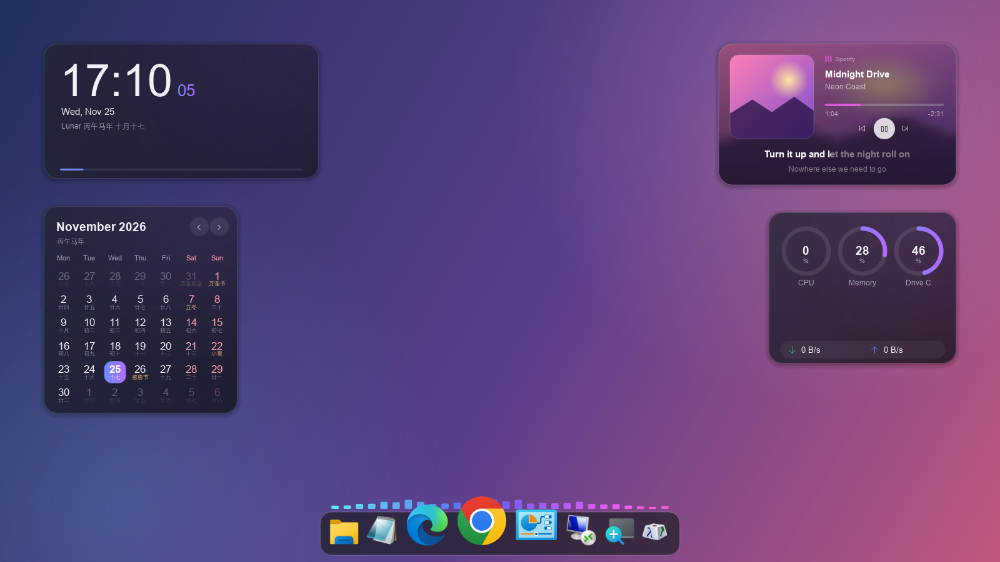
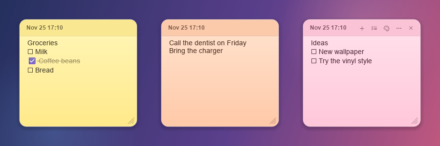
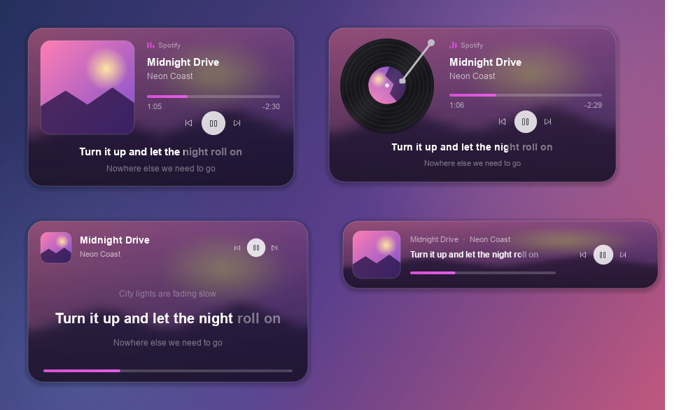
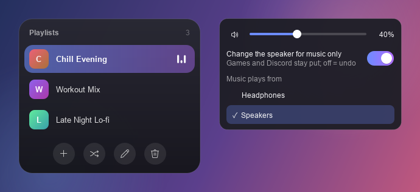

# MyDock

**A magnifying Dock and good-looking desktop widgets for Windows.**

English · [简体中文](docs/README.zh-CN.md)

---

## Contents

- [Features](#features)
- [Download and install](#download-and-install)
- [Quick start](#quick-start)
- [The music card](#the-music-card)
- [Desktop skins (Rainmeter)](#desktop-skins-rainmeter)
- [FAQ](#faq)
- [Privacy](#privacy)
- [Credits, licences and disclaimer](#credits-licences-and-disclaimer)

## Features

| | |
|---|---|
| **Dock** | Icons grow smoothly under the mouse. Several rows or pages when you have lots of apps. Live window previews, unread badges, and `Ctrl+Alt+1…0` to open the first ten apps. |
| **Beat bar** | Bars above the Dock that move with whatever is playing. 10 styles, rainbow / neon / solid colours, and an optional large spectrum on the desktop. |
| **Music card** | Shows the song playing in any app, with cover, controls and synced lyrics. Saves your playlists and can play a whole YouTube playlist in true random order. |
| **Widgets** | Clock, calendar, weather, system monitor and sticky notes. Card, glass, glow and minimal looks; every widget can be moved, resized and recoloured. |
| **Desktop boxes** | Drop files onto a box to tidy the desktop. Tabs inside each box; boxes can sit in the Dock. |
| **Volume ball** | A small floating ball for volume and switching speakers. |
| **Layout templates** | Save how everything looks now and switch to it later with one click. |
| **Auto-update** | A note slides in when a new version is out. One click updates it. |

  
  

  

  

## Download and install

1. Open **[Releases](https://github.com/NineSong0630/MyDock/releases/latest)** and download `MyDock-Setup-x.x.x.exe`.
2. Run it. If Windows shows **"Windows protected your PC"**, click **More info → Run anyway**.
   This message appears for new apps that aren't signed with a paid certificate yet; it's not a virus warning.
3. MyDock starts by itself after installing, and starts with Windows from then on (you can turn that off in **Settings → General**).

**Requirements:** Windows 10 or 11, 64-bit.

## Quick start

1. **Open Settings.** Right-click an empty part of the Dock → **Settings**. You can also run MyDock again from the Start menu while it's running.
2. **Add apps.** Drag a program, shortcut, file or folder onto the Dock. Drag an icon sideways to reorder it, or drag it off the Dock to remove it.
3. **Change the look.** **Settings → Appearance**: theme, icon size, magnification, spacing, transparency and corner radius. *Match wallpaper colours* follows your wallpaper.
4. **Turn on widgets.** **Settings → Built-in widgets**: switch on the clock, calendar, weather, system monitor, music card or sticky notes. Drag a widget to move it; right-click it for its own options (style, size, effects, lock, always on top).
5. **Choose how the Dock behaves.** **Settings → General → Display mode**: *On desktop*, *Always on top* or *Auto-hide* (slides up when the mouse touches the bottom edge).
6. **Save your layout.** **Settings → Layout templates** → type a name → **Save current layout**.

> Tip: almost everything has a right-click menu. If you're not sure how to do something, right-click it.

## The music card

  

The music card works with Spotify, NetEase Cloud Music, QQ Music, browsers (YouTube, etc.) and any other app that shows up in the Windows media controls. Pick a style from its right-click menu: **card**, **vinyl**, **lyrics**, **wide** or **cover**.

  

**Playlists**

1. Copy a playlist link from YouTube Music, YouTube, Spotify or SoundCloud.
2. Right-click the music card → **Switch playlist…** → **+**. The link is read from your clipboard. The first time you use Spotify or YouTube Music, sign in once: right-click the card → **Music app** → show the player window.
3. Switch playlists from the same list. Right-click a playlist to change its name, colour and icon.

**Full shuffle for YouTube playlists (optional)**

YouTube's own shuffle only mixes the first part of a long playlist. MyDock can play every song once, in random order. It needs a free YouTube API key that belongs to you:

1. Turn on **Full shuffle** in the music card's right-click menu. A short guide opens.
2. Click the two buttons in the guide (they open Google Cloud) and create a key. It takes about a minute.
3. Copy the key. MyDock notices it in your clipboard and checks it by itself. That's it.

The key is stored only on your PC and is only sent to Google's YouTube API.

**Change the speaker for music only**

Click the volume icon on the music card and switch on **Change the speaker for music only**. Then the speaker you pick there is used only by your music app. Games and Discord keep using your headset. Switch it off, or quit MyDock, and everything goes back to how it was.

## Desktop skins (Rainmeter)

  

- **Built-in skins** are MyDock's own redraws of the layouts of a few popular Rainmeter skins. They contain no files from the originals. Each one names and links the original author (see [Credits](#credits-licences-and-disclaimer)).
- **Downloaded skins:** MyDock includes an unmodified copy of [Rainmeter](https://www.rainmeter.net/) so you can install `.rmskin` files you download yourself (for example from VisualSkins or DeviantArt). MyDock doesn't include or redistribute any third-party skins. Respect each skin author's licence.

## FAQ

<b>Windows says "Windows protected your PC". Is it safe?</b>

That's Microsoft SmartScreen. It shows for new apps without a paid code-signing certificate. Click **More info → Run anyway**. Only download MyDock from this page's Releases.

<b>How do I update?</b>

Do nothing: when a new version is out, a note slides in at the top of the screen. Click **Update** and it installs and restarts by itself. To check by hand: **Settings → General → Check for updates**.

<b>The Dock disappeared / is off-screen.</b>

Run MyDock again from the Start menu to open Settings, then **General → Dock position → Reset position**.

<b>The music card doesn't show my song.</b>

The app has to show the song in the Windows media controls (the box that appears when you press a volume key). Most music apps and browsers do. Lyrics are looked up online. Some songs, especially instrumental ones, don't have lyrics.

<b>Weather says "No city set".</b>

Click the weather widget and search for your city.

<b>How do I move my setup to another PC?</b>

**Settings → General → Export** gives you one file. Use **Import** on the other PC. MyDock also keeps automatic backups (**Restore backup…**).

<b>How do I uninstall?</b>

**Windows Settings → Apps → Installed apps → MyDock → Uninstall.** Your settings stay in `%APPDATA%\MyDock`; delete that folder too if you want a clean removal.

<b>Something went wrong.</b>

Open an [issue](https://github.com/NineSong0630/MyDock/issues) and attach the log from **Settings → General → Open log folder**.

## Privacy

MyDock runs on your PC. It has no account, no ads and no analytics. It only goes online for:

- **Weather:** the city name or coordinates you chose are sent to [Open-Meteo](https://open-meteo.com/).
- **Lyrics:** the song title and artist are sent to public lyrics services (LRCLIB, NetEase Cloud Music, QQ Music). Found lyrics are cached on your PC.
- **Full shuffle:** the playlist ID is sent with your own API key to the YouTube Data API.
- **Updates:** it checks this repository's latest release on GitHub.

## Credits, licences and disclaimer

**Built-in skin layouts.** These are inspired by, and redrawn from scratch after, these Rainmeter skins. Thanks to their authors:

| MyDock skin | Original skin | Author |
|---|---|---|
| Mond | Mond | [HipHopium](https://www.deviantart.com/hiphopium) |
| Irena | Irena | [ApexXx-SenSei](https://www.deviantart.com/apexxx-sensei) |
| Inside Dream | Inside Dream | [Nasirivand](https://www.deviantart.com/nasirivand) |
| Shadow Clock | Shadow Clock | [SugMadik](https://www.deviantart.com/sugmadik) |

If you're one of these authors and want your credit changed or the skin removed, please [open an issue](https://github.com/NineSong0630/MyDock/issues). We'll respond quickly.

**Bundled software.** MyDock includes Rainmeter 4.5.28 (GPL-2.0, unmodified) and is built with Qt / PySide6 (LGPL-3.0) and other open-source libraries. See [THIRD_PARTY_NOTICES.md](THIRD_PARTY_NOTICES.md) for all licences and source links.

**Data.** Weather data by [Open-Meteo.com](https://open-meteo.com/) (CC BY 4.0). Lyrics and song information belong to their respective rights holders. MyDock only displays them and doesn't redistribute them.

**Trademarks.** MyDock is an independent project. It is not affiliated with, endorsed by or sponsored by Microsoft, Rainmeter, YouTube / Google, Spotify, NetEase, Tencent or any skin author. All product names and trademarks belong to their owners.

---

© 2026 NineSong0630 · MyDock is free to download and use.

