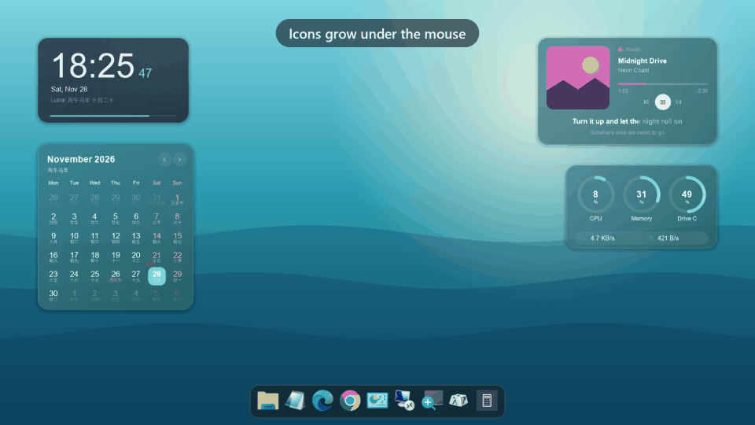
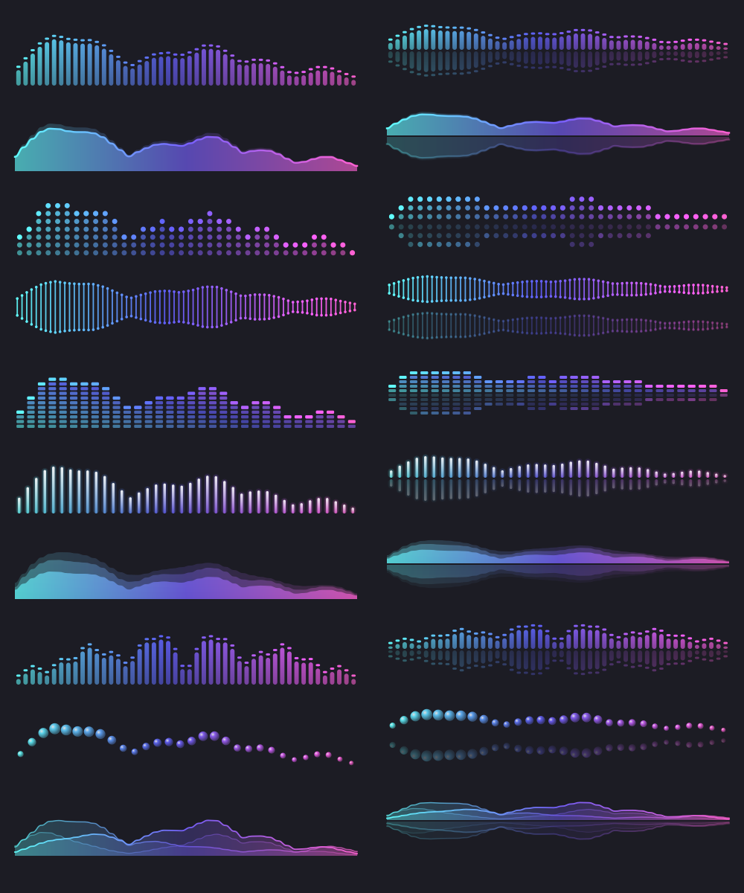
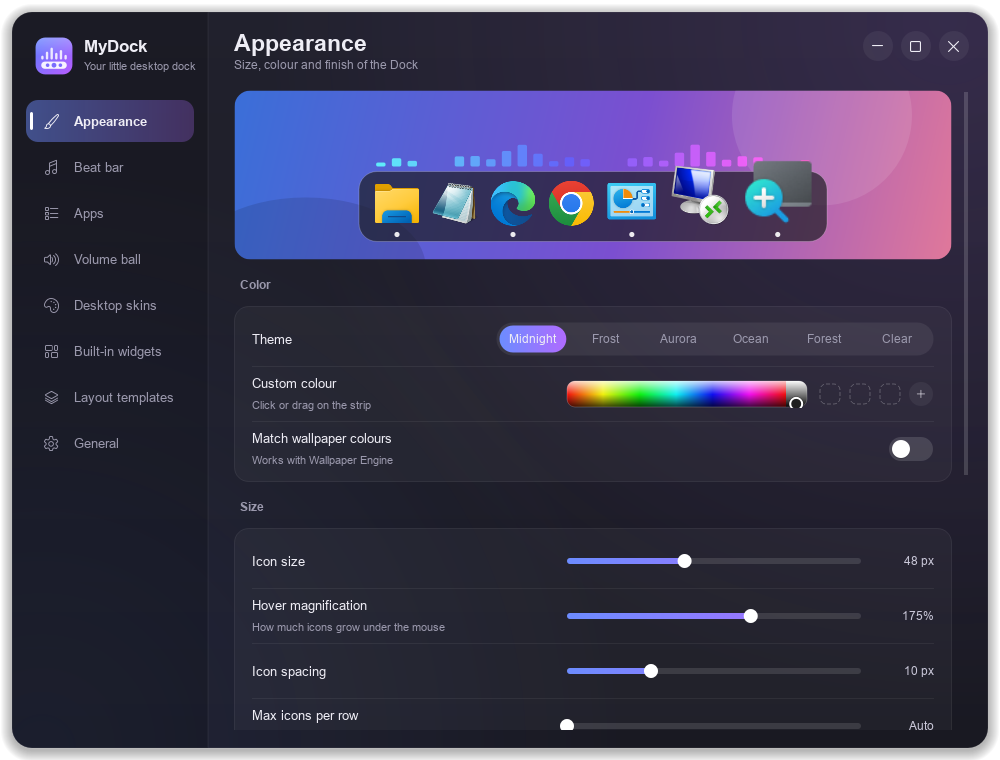
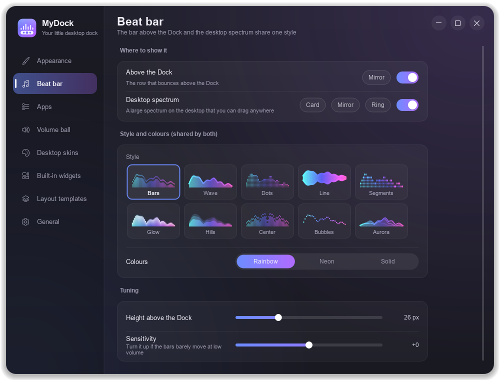
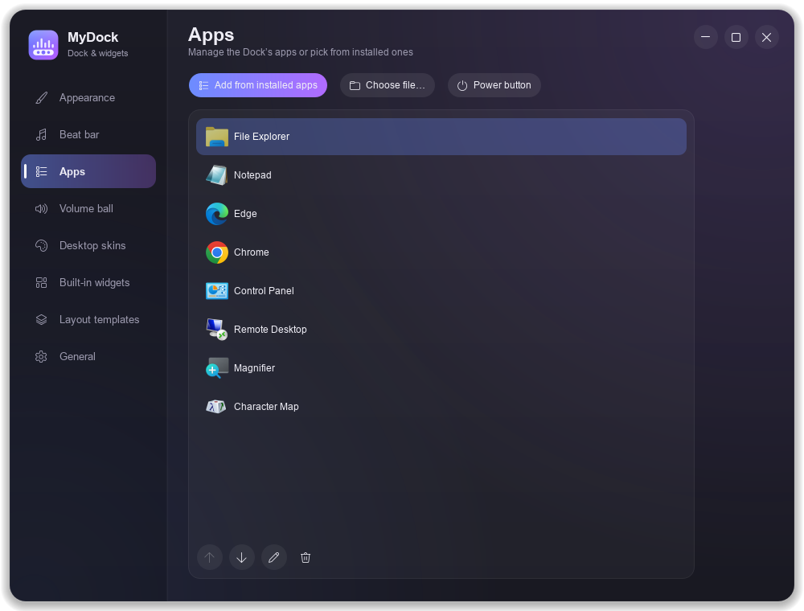
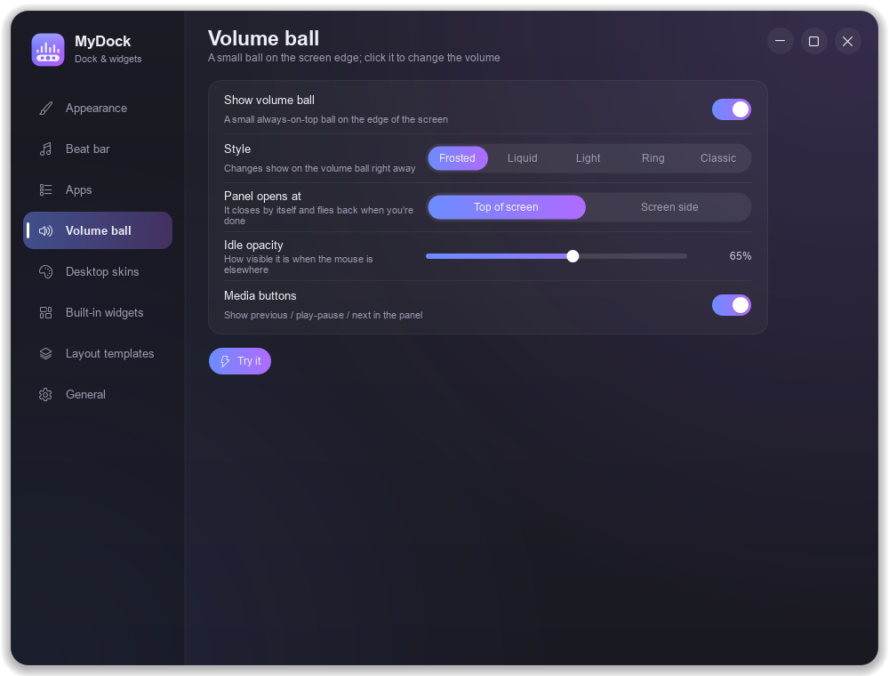
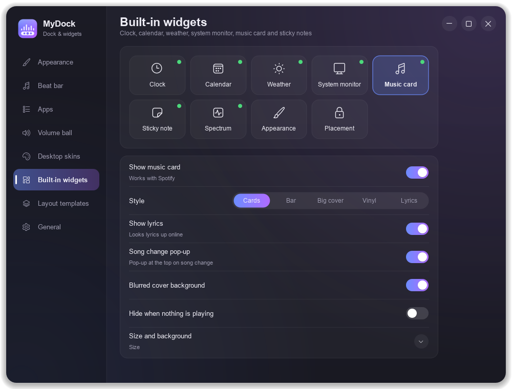
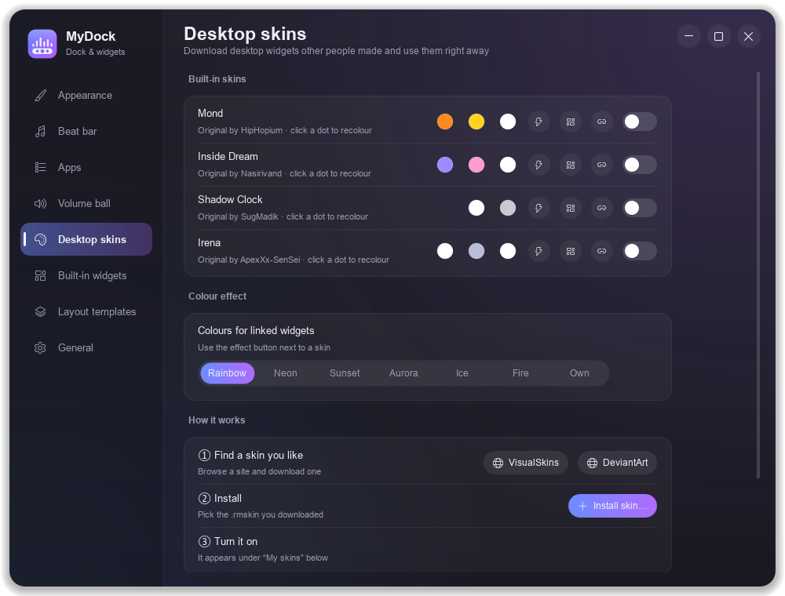

# MyDock

**A magnifying Dock, good-looking desktop widgets, live wallpapers and a music card for Windows, all in one small app.**

English · [简体中文](docs/README.zh-CN.md)

---

## Contents

- [Features](#features)
- [Download and install](#download-and-install)
- [Quick start](#quick-start)
- [A tour of the settings](#a-tour-of-the-settings)
- [The music card](#the-music-card)
- [Share your desktop](#share-your-desktop)
- [Desktop skins (Rainmeter)](#desktop-skins-rainmeter)
- [FAQ](#faq)
- [Privacy](#privacy)
- [Credits, licences and disclaimer](#credits-licences-and-disclaimer)

## Features

| | |
|---|---|
| **Dock** | Icons grow smoothly under the mouse. Several rows or pages when you have lots of apps. Live window previews, unread badges, and `Ctrl+Alt+1…0` to open the first ten apps. |
| **Beat bar** | Bars above the Dock that move with whatever is playing. 10 styles, rainbow / neon / gradient / solid colours, and an optional large spectrum on the desktop. |
| **Music card** | Shows the song playing in any app, with a sharp cover, controls and synced lyrics. Record, sleeve, cassette, CD and polaroid looks. Saves your playlists, plays them hidden in the background, and can play a whole YouTube playlist in true random order. |
| **Wallpapers** | Pictures or videos as wallpaper, changing on a timer, or the song's cover while music plays. Plays Wallpaper Engine's videos smoothly without Wallpaper Engine running. |
| **Match wallpaper colours** | One switch colours the cards, accent, Dock and beat bars after your wallpaper. Don't like it? *Another set*. Switch it off and your own colours come back. |
| **Widgets** | Clock, calendar, weather, system monitor and sticky notes. Card, glass, glow and minimal looks; every widget can be moved, resized and recoloured. |
| **Desktop boxes** | Drop files onto a box to tidy the desktop. Tabs inside each box; boxes can sit in the Dock. |
| **Volume ball** | A small floating ball for volume and switching speakers. |
| **Layout templates** | Save how everything looks now and switch to it later with one click. |
| **Share your desktop** | Pack your look, layout and wallpaper into one file for a friend. It fits their screen size; your apps, playlists and keys stay out. |
| **Auto-update** | A note slides in when a new version is out. One click updates it. |

  

  

## Download and install

1. Open **[Releases](https://github.com/NineSong0630/MyDock/releases/latest)** and download `MyDock-Setup-x.x.x.exe`.
2. Run it and pick your language (English or 简体中文). MyDock uses the same language. You can change it later in **Settings → General → Language**.
3. If Windows shows **"Windows protected your PC"**, click **More info → Run anyway**.
   This message appears for new apps that aren't signed with a paid certificate yet; it's not a virus warning.
4. MyDock starts by itself after installing, and starts with Windows from then on (you can turn that off in **Settings → General**).

**Requirements:** Windows 10 or 11, 64-bit.

## Quick start

1. **Open Settings.** Right-click an empty part of the Dock → **Settings**. You can also run MyDock again from the Start menu while it's running.
2. **Add apps.** Drag a program, shortcut, file or folder onto the Dock. Drag an icon sideways to reorder it, or drag it off the Dock to remove it.
3. **Change the look.** **Settings → Appearance**: theme, icon size, magnification, spacing, transparency and corner radius. *Match wallpaper colours* follows your wallpaper.
4. **Turn on widgets.** **Settings → Built-in widgets**: switch on the clock, calendar, weather, system monitor, music card or sticky notes. Drag a widget to move it; right-click it for its own options (style, size, effects, lock, always on top).
5. **Choose how the Dock behaves.** **Settings → General → Display mode**: *On desktop*, *Always on top* or *Auto-hide* (slides up when the mouse touches the bottom edge).
6. **Save your layout.** **Settings → Layout templates** → type a name → **Save current layout**.

> Tip: almost everything has a right-click menu. If you're not sure how to do something, right-click it.

## A tour of the settings

Open Settings by right-clicking an empty part of the Dock → **Settings**. Every change shows up right away.

### Appearance
Theme, your own colour, *Match wallpaper colours* (with *Another set* to try the next look), icon size, magnification, spacing, rows, transparency and corner radius. The preview at the top updates as you go.

### Beat bar
Show bars above the Dock and/or a large spectrum on the desktop (card, mirror or ring, with the cover inside). Pick one of 10 styles and a colour mode; The bars follow the music's own loudness, so they jump just as much when a song or Windows is turned down; turn *Sensitivity* up for bigger jumps.

**Desktop spectrum shape:** set the number of bars (up to 160), the length and the thickness, and turn it any way you like: across, upright along the left or right edge of the screen, upside down, or tilted at any angle. You can also drag its edges to stretch it, or hold **Shift** and scroll on it to turn it.

### Apps
Everything on the Dock in one list: add from your installed apps, choose a file, or add a power button (shut down / sleep / restart / lock). Reorder, rename or remove with the buttons at the bottom.

### Volume ball
A small ball on the edge of the screen. Click it to change the volume, switch speakers and control music. Choose its style, where the panel opens and how see-through it is when you're not using it.

### Built-in widgets
Turn each widget on and set its own options. For the music card: style (cards, bar, big cover, vinyl, lyrics), lyrics, a pop-up when the song changes, a blurred cover background and *Hide when nothing is playing*. Make a music card bigger and its layout changes with it: the vinyl and cover styles put a large record or cover on top with the song below. The volume button on the card also lets you switch speakers. **Appearance** sets one look for all widgets and **Placement** lines them up neatly.

### Wallpaper
Use your own pictures or videos, let them change on a timer, or show the song's cover while music plays. Videos you downloaded in Wallpaper Engine play straight from MyDock on the GPU, just as smooth, with less CPU and memory; Wallpaper Engine scenes are listed too and handed to Wallpaper Engine. Group wallpapers and hide the ones you don't want.

### Desktop skins
Built-in skins you can recolour with one click, plus a 3-step guide for installing skins you download (see [Desktop skins](#desktop-skins-rainmeter)).

### Layout templates
Type a name and click **Save current layout**. Switch between your saved looks (for example *Work* and *Game night*) with one click, here or from the tray icon.

### General
Start with Windows, language, help text (full, short or off), Dock position, display mode (*On desktop*, *Always on top*, *Auto-hide*), multiple screens, window previews, unread badges, keyboard shortcuts, backup, *Share desktop theme* and automatic updates.

## The music card

  

The music card works with Spotify, NetEase Cloud Music, QQ Music, browsers (YouTube, etc.) and any other app that shows up in the Windows media controls. Pick a style from its right-click menu: **card**, **vinyl**, **lyrics**, **wide** or **cover**, then dress the record as a clear cassette, a record sleeve, a CD or a polaroid in any colour. When a player only gives a small blurry cover, MyDock finds a sharp one.

  

**Playlists**

1. Copy a playlist link from YouTube Music, YouTube, Spotify or SoundCloud.
2. Right-click the music card → **Switch playlist…** → **+**. The link is read from your clipboard. The first time you use Spotify or YouTube Music, sign in once: right-click the card → **Music app** → show the player window.
3. Switch playlists from the same list. Right-click a playlist to change its name, colour and icon. Picking a playlist while other music plays pauses that and switches to your list.
4. Playlists play in a hidden background player with no window or taskbar icon. If you restart, update or shut down while it plays, it carries on from the same song next time.

**Full shuffle for YouTube playlists (optional)**

YouTube's own shuffle only mixes the first part of a long playlist. MyDock can play every song once, in random order. It needs a free YouTube API key that belongs to you:

1. Turn on **Full shuffle** in the music card's right-click menu. A short guide opens.
2. Click the two buttons in the guide (they open Google Cloud) and create a key. It takes about a minute.
3. Copy the key. MyDock notices it in your clipboard and checks it by itself. That's it.

The key is stored only on your PC and is only sent to Google's YouTube API.

**Change the speaker for music only**

Click the volume icon on the music card and switch on **Change the speaker for music only**. Then the speaker you pick there is used only by your music app. Games and Discord keep using your headset. Switch it off, or quit MyDock, and everything goes back to how it was.

## Share your desktop

**Settings → General → Share desktop theme** packs your desktop into one file you can send to a friend:

- **Comes along:** the look and colours of the Dock and every widget, which ones are on or off, and where everything sits. Positions are kept relative to the screen edges, so a widget in the top-right corner of your 4K screen lands in the top-right of a friend's 1080p one.
- **Wallpaper:** your own picture (or a video up to 300 MB) is packed in. A Wallpaper Engine workshop wallpaper is sent as a link: your friend clicks *Subscribe*, and MyDock puts it on as soon as Steam has downloaded it.
- **Rainmeter skins** are packed in when their author's licence allows sharing; otherwise your friend gets a link to find them.
- **Stays with you:** your Dock apps, playlists, YouTube key, weather city, sticky notes, calendar notes and templates.

Your friend sees a preview picture before importing it. Your city, song and playlist names are hidden in the preview.

## Desktop skins (Rainmeter)

  

- **Built-in skins** are MyDock's own redraws of the layouts of a few popular Rainmeter skins. They contain no files from the originals. Each one names and links the original author (see [Credits](#credits-licences-and-disclaimer)).
- **Downloaded skins:** MyDock includes an unmodified copy of [Rainmeter](https://www.rainmeter.net/) so you can install `.rmskin` files you download yourself (for example from VisualSkins or DeviantArt). MyDock doesn't include or redistribute any third-party skins. Respect each skin author's licence.

## FAQ

<b>Windows says "Windows protected your PC". Is it safe?</b>

That's Microsoft SmartScreen. It shows for new apps without a paid code-signing certificate. Click **More info → Run anyway**. Only download MyDock from this page's Releases.

<b>How do I change the language?</b>

**Settings → General → Language**. MyDock asks whether to restart now. It closes for a few seconds, shows *"back in a moment"* at the top of the screen and opens again in the new language.

<b>How do I update?</b>

Do nothing: when a new version is out, a note slides in at the top of the screen. Click **Update** and it installs and restarts by itself. To check by hand: **Settings → General → Check for updates**.

<b>The Dock disappeared / is off-screen.</b>

Run MyDock again from the Start menu to open Settings, then **General → Dock position → Reset position**.

<b>The music card doesn't show my song.</b>

The app has to show the song in the Windows media controls (the box that appears when you press a volume key). Most music apps and browsers do. Lyrics are looked up online. Some songs, especially instrumental ones, don't have lyrics.

<b>Weather says "No city set".</b>

Click the weather widget and search for your city.

<b>How do I move my setup to another PC?</b>

For the look and layout: **Settings → General → Share desktop theme → Export…**, then **Import…** on the other PC. To bring everything, including your Dock apps, playlists and notes, copy the folder `%APPDATA%\MyDock` to the same place on the other PC while MyDock is closed. MyDock also keeps automatic backups (**Restore backup…**).

<b>How do I uninstall?</b>

**Windows Settings → Apps → Installed apps → MyDock → Uninstall.** Your settings stay in `%APPDATA%\MyDock`; delete that folder too if you want a clean removal.

<b>Something went wrong.</b>

Open an [issue](https://github.com/NineSong0630/MyDock/issues) and attach the log from **Settings → General → Open log folder**.

## Privacy

MyDock runs on your PC. It has no account, no ads and no analytics. It only goes online for:

- **Weather:** the city name or coordinates you chose are sent to [Open-Meteo](https://open-meteo.com/).
- **Lyrics:** the song title and artist are sent to public lyrics services (LRCLIB, NetEase Cloud Music, QQ Music). Found lyrics are cached on your PC.
- **Sharp covers:** when a player's cover is small, the song title and artist are sent to Apple's iTunes search, once per song, and the cover is cached on your PC (at most 50 MB). You can turn this off in the music card's settings.
- **Full shuffle:** the playlist ID is sent with your own API key to the YouTube Data API.
- **Updates:** it checks this repository's latest release on GitHub.

## Credits, licences and disclaimer

**Built-in skin layouts.** These are inspired by, and redrawn from scratch after, these Rainmeter skins. Thanks to their authors:

| MyDock skin | Original skin | Author |
|---|---|---|
| Mond | Mond | [HipHopium](https://www.deviantart.com/hiphopium) |
| Irena | Irena | [ApexXx-SenSei](https://www.deviantart.com/apexxx-sensei) |
| Inside Dream | Inside Dream | [Nasirivand](https://www.deviantart.com/nasirivand) |
| Shadow Clock | Shadow Clock | [SugMadik](https://www.deviantart.com/sugmadik) |

If you're one of these authors and want your credit changed or the skin removed, please [open an issue](https://github.com/NineSong0630/MyDock/issues). We'll respond quickly.

**Bundled software.** MyDock includes Rainmeter 4.5.28 (GPL-2.0, unmodified) and is built with Qt / PySide6 (LGPL-3.0) and other open-source libraries. See [THIRD_PARTY_NOTICES.md](THIRD_PARTY_NOTICES.md) for all licences and source links.

**Data.** Weather data by [Open-Meteo.com](https://open-meteo.com/) (CC BY 4.0). Lyrics and song information belong to their respective rights holders. MyDock only displays them and doesn't redistribute them.

**Trademarks.** MyDock is an independent project. It is not affiliated with, endorsed by or sponsored by Microsoft, Rainmeter, YouTube / Google, Spotify, NetEase, Tencent or any skin author. All product names and trademarks belong to their owners.

---

© 2026 NineSong0630 · MyDock is free to download and use.

