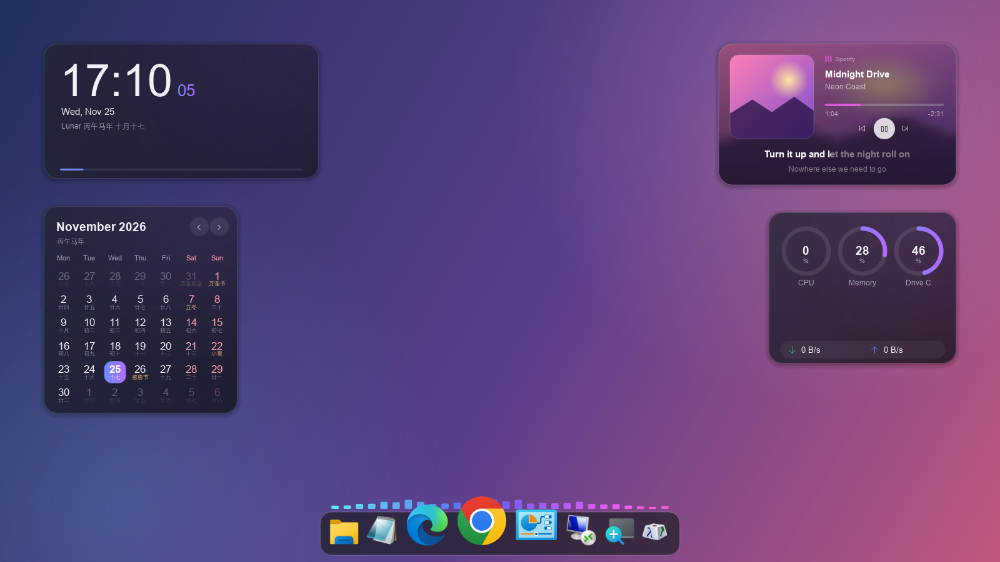
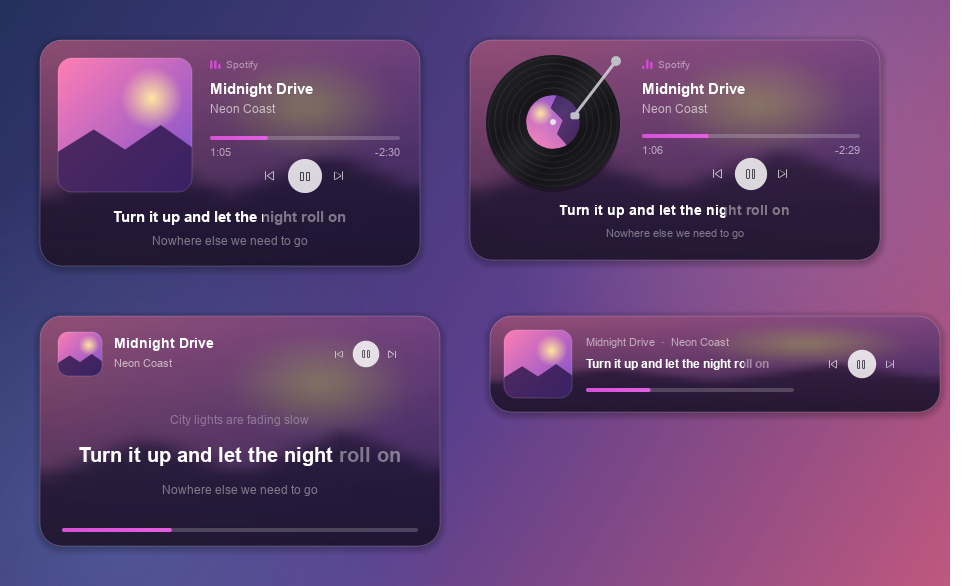
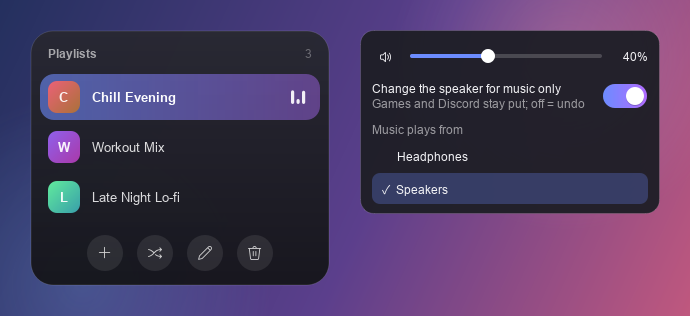
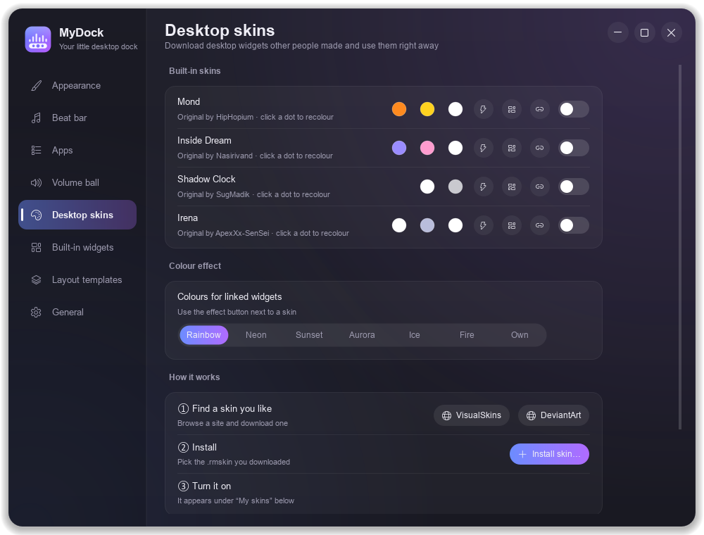

# MyDock

**Windows 上会放大的 Dock 和好看的桌面小组件。**

[English](../README.md) · 简体中文

---

## 功能一览

| | |
|---|---|
| **Dock** | 鼠标经过时图标会顺滑地放大；程序多了可以多行或分页；悬停预览窗口、新消息红点，`Ctrl+Alt+1…0` 直接打开前 10 个程序。 |
| **律动条** | Dock 上方跟着音乐跳动的条。10 种样式，彩虹 / 霓虹 / 单色，还能在桌面放一个大频谱。 |
| **音乐卡片** | 显示正在播放的歌曲：封面、控制按钮、同步歌词。可以存多个歌单，YouTube 歌单能真正完整随机播放。 |
| **小组件** | 时钟、日历、天气、系统监控、便利贴。卡片、玻璃、发光、极简等风格，每个都能拖动、调大小、换颜色。 |
| **收纳格** | 把文件拖进格子里整理桌面，格子里还能分标签，也能放进 Dock。 |
| **音量球** | 桌面上的小圆球，调音量、切换音响。 |
| **布局模板** | 把现在的样子存起来，一键切换。 |
| **自动更新** | 有新版本时屏幕上方弹出提示，点一下就更新。 |

## 下载安装

1. 打开 **[Releases](https://github.com/NineSong0630/MyDock/releases/latest)**，下载 `MyDock-Setup-x.x.x.exe`。
2. 双击安装。如果出现 **「Windows 已保护你的电脑」**，点 **更多信息 → 仍要运行**。
   这是因为新软件还没有付费的数字签名，不是病毒提示。
3. 装好后 MyDock 会自己打开，以后开机自动启动（可在 **设置 → 常规** 关掉）。

**系统要求：** Windows 10 / 11，64 位。

## 快速上手

1. **打开设置：** 右键 Dock 空白处 → **设置**。MyDock 已经在运行时，从开始菜单再打开一次也会弹出设置。
2. **添加程序：** 把程序、快捷方式、文件或文件夹拖到 Dock 上。左右拖动图标可以排序，拖出 Dock 就是移除。
3. **换外观：** **设置 → 外观**：主题、图标大小、放大倍数、间距、透明度、圆角。打开「跟壁纸自动配色」会跟着壁纸变色。
4. **打开小组件：** **设置 → 内置组件**：时钟、日历、天气、系统监控、音乐卡片、便利贴。拖动就能移动，右键有它自己的选项（风格、大小、特效、锁定、总在最前面）。
5. **Dock 显示方式：** **设置 → 常规 → 显示方式**：贴在桌面 / 总在最前 / 自动隐藏（鼠标碰到屏幕底部才滑出来）。
6. **存成模板：** **设置 → 布局模板** → 输入名字 → **保存当前布局**。

> 小提示：几乎所有东西都有右键菜单，不知道怎么弄就右键看看。

## 音乐卡片

支持 Spotify、网易云音乐、QQ 音乐、浏览器（YouTube 等），以及所有会出现在 Windows 媒体控制里的 App。右键卡片可以换样式：卡片、黑胶、歌词、宽条、大封面。

**歌单**

1. 复制 YouTube Music、YouTube、Spotify 或 SoundCloud 的歌单链接。
2. 右键音乐卡片 → **切换歌单…** → **+**，会自动读取剪贴板里的链接。第一次用 Spotify / YouTube Music 要先登录一次：右键卡片 → **音乐 App** → 显示播放器窗口。
3. 在同一个列表里切换歌单；右键某个歌单可以改名字、颜色和图标。

**YouTube 完整随机（可选）**

YouTube 自带的随机常常只在一小段里转。MyDock 可以让每首歌都播到一遍，需要一个你自己的免费 YouTube API key：

1. 在卡片右键菜单打开 **完整随机**，会弹出一个小向导。
2. 点向导里的两个按钮（会打开 Google Cloud），建一个 key，大概一分钟。
3. 复制 key，MyDock 会自己从剪贴板读到并检查好，完成。

key 只存在你的电脑上，只会发给 Google 的 YouTube API。

**只换音乐的音响**

点音乐卡片上的音量图标，打开 **只换音乐的音响**。之后在那里选的音响只给音乐 App 用，游戏和 Discord 还是走你的耳机。关掉它或退出 MyDock，就全部恢复原样。

## 桌面皮肤（Rainmeter）

- **内置皮肤**：MyDock 参照几款热门 Rainmeter 皮肤的版式自己重新画的，没有使用原作的任何文件，每一款都标注并链接了原作者（见英文版 README 的 Credits）。
- **下载的皮肤**：MyDock 附带一份未修改的 [Rainmeter](https://www.rainmeter.net/)，让你安装自己下载的 `.rmskin`（比如 VisualSkins、DeviantArt）。MyDock 不附带、不转发任何第三方皮肤，请遵守每位皮肤作者的授权。

## 常见问题

<b>提示「Windows 已保护你的电脑」，安全吗？</b>

这是 Microsoft SmartScreen，没有付费代码签名证书的新软件都会这样。点 **更多信息 → 仍要运行**。请只从本页面的 Releases 下载。

<b>怎么更新？</b>

不用管：有新版本时屏幕上方会弹出提示，点 **更新** 就会自己安装并重新打开。也可以在 **设置 → 常规 → 检查更新** 手动检查。

<b>Dock 不见了 / 跑到屏幕外面了</b>

从开始菜单再打开一次 MyDock 弹出设置，然后 **常规 → Dock 位置 → 回到默认位置**。

<b>音乐卡片没显示我的歌</b>

播放器要出现在 Windows 媒体控制里（按音量键时弹出的那个框），大部分音乐 App 和浏览器都会。歌词是在线查找的，有些歌（特别是纯音乐）没有歌词。

<b>天气显示「还没有设置城市」</b>

点一下天气组件，搜索你的城市。

<b>换电脑怎么把设置带过去？</b>

**设置 → 常规 → 导出** 得到一个文件，在新电脑 **导入** 就行。MyDock 也会自动备份（**恢复备份…**）。

<b>怎么卸载？</b>

**Windows 设置 → 应用 → 已安装的应用 → MyDock → 卸载**。设置文件在 `%APPDATA%\MyDock`，想彻底删干净就把这个文件夹也删掉。

<b>出问题了</b>

到 [Issues](https://github.com/NineSong0630/MyDock/issues) 留言，附上 **设置 → 常规 → 打开日志文件夹** 里的日志。

## 隐私

MyDock 在你的电脑上运行，没有账号、没有广告、不收集使用数据。只有这些情况会联网：

- **天气**：把你选的城市名或坐标发给 [Open-Meteo](https://open-meteo.com/)。
- **歌词**：把歌名和歌手发给公开的歌词服务（LRCLIB、网易云音乐、QQ 音乐），找到的歌词缓存在你电脑上。
- **完整随机**：用你自己的 key 把歌单 ID 发给 YouTube Data API。
- **更新**：在 GitHub 上检查本仓库的最新版本。

## 版权与声明

- 内置皮肤的版式灵感来自 HipHopium（Mond）、ApexXx-SenSei（Irena）、Nasirivand（Inside Dream）、SugMadik（Shadow Clock）的 Rainmeter 皮肤，由 MyDock 重新绘制。原作者如希望修改署名或移除，请到 [Issues](https://github.com/NineSong0630/MyDock/issues) 联系，我们会尽快处理。
- MyDock 附带未修改的 Rainmeter 4.5.28（GPL-2.0），使用 Qt / PySide6（LGPL-3.0）等开源软件，详见 [THIRD_PARTY_NOTICES.md](../THIRD_PARTY_NOTICES.md)。
- 天气数据来自 [Open-Meteo.com](https://open-meteo.com/)（CC BY 4.0）。歌词和歌曲信息的版权属于各自的权利人，MyDock 只显示，不转发。
- MyDock 是独立项目，与 Microsoft、Rainmeter、YouTube / Google、Spotify、网易、腾讯及各位皮肤作者没有关联，也没有得到它们的认可或赞助。所有产品名称和商标归各自所有者。

---

© 2026 NineSong0630 · MyDock 免费下载使用

